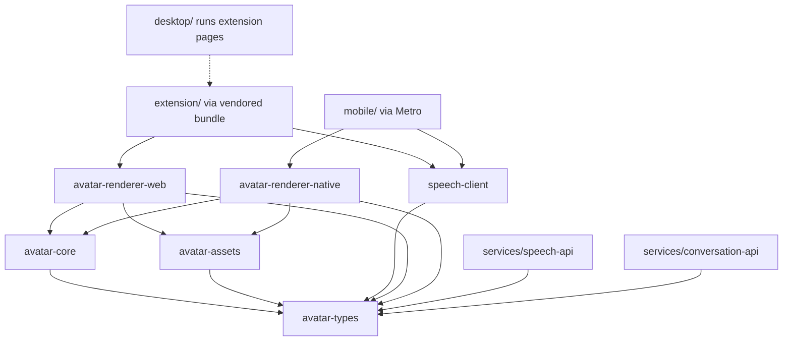
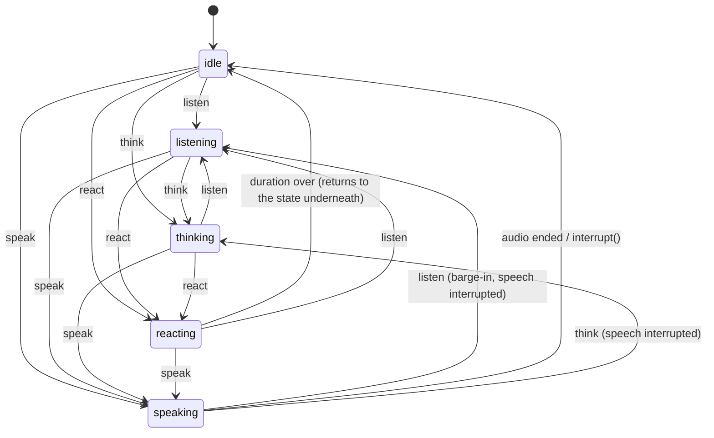
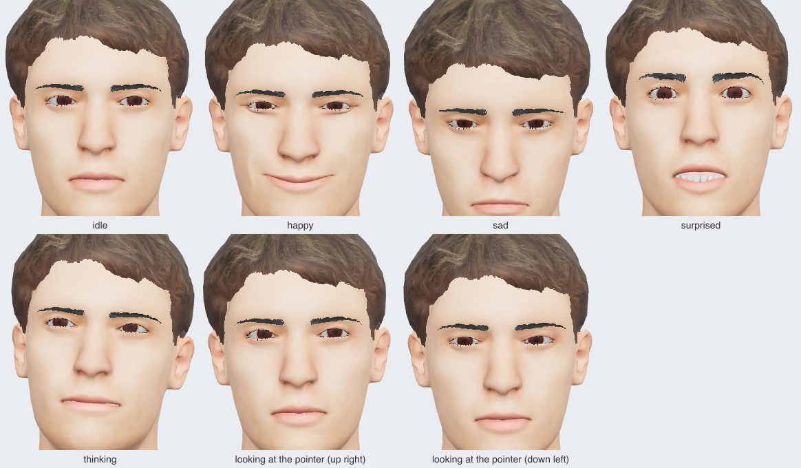

# Digital human engine: architecture and plan

Status: **Phases 1 to 4 done** (workspace, shared types, `avatar-core` with its face, eye and
procedural layers, the human model, the web renderer). Phases 5 to 9 are planned, not built. All phases
go on one branch, `feat/digital-human`.

The engine renders one interactive 3D human (idle, listening, thinking, speaking, reacting) in the three
Squat Overflow clients: the browser extension, the desktop app and the mobile app. It follows the repo
rules in [CLAUDE.md](../../CLAUDE.md): the engine's rules live in one shared place and every client runs
them as is, the desktop app keeps running the extension's pages unchanged, and each platform gap is
written down.

Related: [assets.md](assets.md) (3D asset requirements and import pipeline).

## 1. Where things live

The spec asked for `apps/browser-extension`, `apps/desktop` and `apps/mobile`. This repo already has those
three clients, so the engine ships as packages that the existing clients use. There is no `apps/` folder.

| Spec name              | In this repo | Role                                                      |
| ---------------------- | ------------ | --------------------------------------------------------- |
| apps/browser-extension | `extension/` | Avatar side panel page (Phase 6)                          |
| apps/desktop           | `desktop/`   | Runs the extension's avatar page in a floating window (7) |
| apps/mobile            | `mobile/`    | Native renderer, picked after the mobile spike (Phase 8)  |
| packages/\*            | `packages/*` | The engine (this workspace)                               |
| services/\*            | `services/*` | Server-side speech and conversation (Phase 5 and later)   |

```
.
├── package.json              private root: workspace scripts only (pnpm + Turborepo)
├── pnpm-workspace.yaml       packages/*, services/*, tools/*; pinned tool versions (catalog)
├── turbo.json                typecheck, lint, test
├── tsconfig.base.json        strict compiler settings every package extends
├── eslint.config.mjs         typescript-eslint strictTypeChecked, workspace files only
├── .prettierrc.json          same style as mobile/
├── packages/
│   ├── avatar-types/            Phase 1  shared contracts: states, commands, events, speech, frame, assets
│   ├── avatar-core/             Phase 2  controller, state machine, facial/eye/viseme/procedural layers
│   ├── avatar-assets/           Phase 3  the human's GLB files, manifest, validator, build script
│   ├── avatar-renderer-web/     Phase 3  three.js + React Three Fiber renderer (extension, desktop)
│   ├── avatar-renderer-native/  Phase 8  mobile renderer (stack chosen by spike S1)
│   └── speech-client/           Phase 5  fetches and checks SpeechResponse; mock provider
├── services/
│   ├── speech-api/              Phase 5  TTS proxy; holds the provider key, never the clients
│   ├── conversation-api/        later    dialogue backend
│   └── asset-delivery/          Phase 9  only if the GLB is downloaded instead of bundled
├── tools/
│   └── workspace-check/         Phase 1  pins the package boundaries (below)
├── extension/  desktop/  mobile/  server/   existing clients and API (npm, unchanged in Phase 1)
└── docs/digital-human/          this plan, asset pipeline
```

Only the new code is in the pnpm workspace. `extension/`, `mobile/`, `server/` and `vscode-extension/`
keep their own npm lockfiles, CI jobs and release flow. Moving them into the workspace is not needed to
share code and would change every existing CI job and the release workflow.

Packages ship TypeScript source (`"exports": "./src/index.ts"`), with no build step. Vite (web), Metro
(mobile) and Node 24 type stripping (services) all read it directly. The compiler settings make that
safe: `erasableSyntaxOnly` (no enums or namespaces), `verbatimModuleSyntax` and `.ts` import extensions.
The standard library is ES2022 (`tsconfig.base.json`), so shared code can't call ES2023 methods such as
`Array.prototype.toSorted` that Hermes may lack; raise it only after checking Hermes on RN 0.85.

### How each client will use the engine

- **Extension.** It has no build step and must keep loading unpacked. `avatar-renderer-web` gets a
  bundling script that writes one self-contained ES module into `extension/lib/vendor/`, the same way
  three.js and MediaPipe are vendored today. A new extension page (the side panel) imports it.
- **Desktop.** Nothing new on the JS side: it already runs the extension pages through
  `desktop/shim/chrome-shim.js`. The Rust shell adds a floating, frameless, always-on-top window that
  loads the avatar page, plus microphone permission. Those are `chrome.*`/window APIs, not engine rules.
- **Mobile.** Metro already watches `../extension`; it will also watch `../packages`, the same way
  `mobile/src/core/shared.ts` imports the extension's pure modules today. `avatar-core` and `speech-client`
  run unchanged on Hermes. The renderer is `avatar-renderer-native`.

## 2. Package dependency graph



`tools/workspace-check` enforces these rules on every `pnpm check`:

| Package                | May use workspace packages | Must never use                                                 |
| ---------------------- | -------------------------- | -------------------------------------------------------------- |
| avatar-types           | none                       | React, three, Zustand, Expo, React Native, Tauri; host globals |
| avatar-core            | avatar-types               | React, three, Zustand, Expo, React Native, Tauri; host globals |
| avatar-assets          | avatar-types               | React, three, Zustand, Expo, React Native, Tauri; host globals |
| speech-client          | avatar-types               | React, three, Zustand, Expo, React Native, Tauri; host globals |
| avatar-renderer-web    | core, assets, types        | Expo, React Native, Tauri                                      |
| avatar-renderer-native | core, assets, types        | react-dom, Tauri                                               |
| services/\*            | avatar-types               | React, three, Zustand, Expo, React Native, Tauri               |
| workspace-check        | none                       | (no limits; it's a dev tool)                                   |

Each dependency field counts (`dependencies`, `devDependencies`, `peerDependencies`,
`optionalDependencies`), and a workspace package without a rule fails the check. The exact name lists
are in [`tools/workspace-check/src/rules.ts`](../../tools/workspace-check/src/rules.ts).

"Host globals" means the package's compiled program loads no DOM or web worker lib and no Node or React
Native global types. The check builds the package's real TypeScript program from what it ships (test
files are left out; a test that reads files from disk starts with `/// <reference types="node" />`) and
lists the files it loads, so a global pulled in indirectly fails it too. The compiler then rejects `window`, `document`, `fetch`,
`setTimeout`, `console` and `performance` in those packages. Time, randomness, audio and network reach them only through the ports
in `avatar-types` (`MonotonicClock`, `RandomSource`, `AudioPort`, an injected fetch). This is what keeps
`avatar-core` free of browser APIs, and it also makes it deterministic to test.

No package may depend on a service. Clients reach services over HTTP only, so provider keys stay on the
server.

## 3. Shared TypeScript interfaces

All in [`packages/avatar-types/src`](../../packages/avatar-types/src). The runtime parts (constant lists
and parsers for data that crosses a trust boundary) are tested; the rest are types.

| File             | Contents                                                                               |
| ---------------- | -------------------------------------------------------------------------------------- |
| `states.ts`      | `AVATAR_STATES`: idle, listening, thinking, speaking, reacting                         |
| `expressions.ts` | `AVATAR_EXPRESSIONS` (neutral, happy, sad, surprised, confused, thinking), `REACTIONS` |
| `blendshapes.ts` | `ARKIT_BLENDSHAPES`: the 52 ARKit face shapes                                          |
| `visemes.ts`     | `VISEMES`: the 15 Oculus visemes (`sil`, `PP`, `FF`, … `U`), `isVisemeId`              |
| `speech.ts`      | `SpeechResponse`, `VisemeEvent`, `parseSpeechResponse`                                 |
| `commands.ts`    | `AvatarCommand` union, `parseAvatarCommand`                                            |
| `events.ts`      | `AvatarEvent` union, `AvatarEventListener`                                             |
| `controller.ts`  | `AvatarController` (the spec's API, plus `on()`), `CommandOutcome`                     |
| `ports.ts`       | `MonotonicClock`, `RandomSource`, `AudioPort`, `AudioPlayback`                         |
| `frame.ts`       | `AvatarFrame`: what core hands the renderer each frame                                 |
| `assets.ts`      | `QualityProfile`, `AvatarAssetManifest`, `HUMANOID_BONES`, `ANIMATION_SLOTS`           |
| `math.ts`        | `Vec3`, `HeadRotation`, `EyeRotation`                                                  |
| `parse.ts`       | `ParseResult<T>`                                                                       |

Choices that refine the spec:

- **Units.** Every time in the engine is in milliseconds from the start of the audio. `SpeechResponse.duration`,
  `VisemeEvent.timestamp` and `VisemeEvent.duration` are all ms. Angles are radians.
- **`VisemeEvent.viseme`** is typed `VisemeId` (one of the 15), not `string`. `parseSpeechResponse` checks
  it when data arrives from the server. Providers' own viseme sets (Polly, Azure) are mapped to these on the
  server, in `speech-api`.
- **`execute()` returns `Promise<CommandOutcome>`** (`'completed' | 'interrupted'`) instead of
  `Promise<void>`. Code written against `Promise<void>` still works; code that needs to know whether speech
  finished or was cut off doesn't have to listen for events. It rejects only on a real failure (audio
  failed to load).
- **`on(type, listener)`** is added to the controller so callers get typed events. It returns an
  unsubscribe function.
- **`speak` takes a `SpeechResponse`, not text.** Turning text into audio and visemes is `speech-client`'s
  job, so core never touches the network.
- **`AvatarFrame`** is the one seam between core and renderers: ARKit blendshape weights, viseme weights,
  head and eye rotations, breathing, and animation clip weights. Core computes it; renderers only apply
  it. That's why every client looks and moves the same.

## 4. Avatar state machine



Two layers:

1. **Activity** (idle, listening, thinking, speaking). Exactly one is active. The newest command wins.
   Leaving `speaking` for anything stops the audio, emits `speechEnded { reason: 'interrupted' }` and
   resolves that `speak` call with `'interrupted'`. Speech that plays to its end goes back to idle.
2. **Reaction** (happy, sad, surprised, confused, neutral). Short and on top. In idle, listening or
   thinking, `react` moves to `reacting` for `durationMs` (default 1500 ms) and then returns to the
   activity underneath. In `speaking`, a reaction never cuts the speech: it becomes an expression overlay
   and the state stays `speaking`. Any command other than `react` ends the current reaction, overlay
   included. If speech ends while an overlay reaction still has time left, the avatar shows `reacting`
   until it's over, then idle.

Priority, highest first:

| Rank | Source                        | Example                                                         |
| ---- | ----------------------------- | --------------------------------------------------------------- |
| 1    | `interrupt()` / `dispose()`   | stops everything, back to idle (dispose: no more frames/events) |
| 2    | Speaking                      | a `react` during speech is an overlay, not a state change       |
| 3    | Commanded activity / reaction | listen, think, react                                            |
| 4    | `setGaze` / `setExpression`   | override the state's default gaze and expression                |
| 5    | Procedural layer              | blinking, breathing, head drift, saccades, acknowledgment nods  |

Lower ranks fill whatever the higher ranks leave free. For example, blinking keeps running while speaking,
but a blink waits while the eyes are wide in `surprised`.

The face that shows, highest first: the reaction's (also as an overlay on speech, scaled by its
`intensity`), the speak command's `expression`, `setExpression`'s, the state's own (`thinking` while
thinking; otherwise neutral). The gaze: `setGaze`'s point, else the state's own way of looking.

| Command → / state ↓ | idle                  | listening                  | thinking                  | speaking                             | reacting              |
| ------------------- | --------------------- | -------------------------- | ------------------------- | ------------------------------------ | --------------------- |
| `idle`              | stays                 | → idle                     | → idle                    | interrupt speech → idle              | → idle                |
| `listen`            | → listen              | stays                      | → listen                  | interrupt speech → listen            | end reaction → listen |
| `think`             | → think               | → think                    | stays                     | interrupt speech → think             | end reaction → think  |
| `speak`             | → speak               | → speak                    | → speak                   | replace speech (old one interrupted) | end reaction → speak  |
| `react`             | → react, back to idle | → react, back to listening | → react, back to thinking | overlay, stays speaking              | replace reaction      |

What each state does (built in Phases 2 and 4; lip sync in Phase 5). In every state the avatar
breathes, blinks (every 2 to 6 s, sometimes twice) and its head drifts slowly; the eyes jump to what
they look at and the head follows big shifts.

- **idle**: about 14 breaths a minute; the eyes wander, back at the user for about a third of the looks.
- **listening**: eye contact, moving between the user's eyes and mouth; leaning in with the head tilted;
  a nod every 4 to 9 s, sometimes two.
- **thinking**: head tilt, eyes up and to one side (the same side all through), the `thinking` face,
  slower breathing; the thinking clip when the model has one.
- **speaking**: audio plays (Phase 5: the mouth follows the visemes on the audio clock); mostly eye
  contact with glances away, the command's expression, quicker breathing; the talking clip.
- **reacting**: the reaction's face and posture (sad looks down, surprised lifts the head, confused
  tilts it), eye contact, and its clip.

Transitions blend, driven by the renderer calling `frame()` once per displayed frame. Body clips
crossfade over 300 ms (`CLIP_FADE_MS`) and their weights always sum to 1, also when the target changes
mid-fade; a clip that comes back while still fading out keeps its place. A reaction without a clip of its
own (`neutral`, or one the model lacks) keeps the activity's clip, and a missing activity clip falls back
to idle. After a long gap between frames (a hidden page) the animation moves on at most 100 ms
(`MAX_FRAME_STEP_MS`) instead of jumping. Reactions are timed on the clock, not on frames, so a reaction
whose time ran out while the page was hidden counts as completed. Faces, postures and gaze move
towards their goal with time constants rather than fixed fades (face 120 ms, posture 300 ms, an eye jump
20 ms, the head following the eyes 250 ms), so a change in the middle of another never jumps, and the
result depends only on the time that passed: the avatar looks the same at 30 and 60 fps.

### Events

- Order: `stateChanged` (into speaking), then `speechStarted`; at the end `speechEnded`, then
  `stateChanged` (out of speaking). Every `speechStarted` is followed by exactly one `speechEnded`,
  whose reason is `completed`, `interrupted` (a command, `interrupt()`, or the system stopped the audio,
  e.g. a phone call) or `failed` (the audio couldn't load or play; the `speak` call rejects with an
  `Error`). `dispose()` interrupts first and emits `disposed` last.
- Listeners only ever see a consistent avatar: events are delivered after the call that caused them has
  finished changing state. A command issued from inside a listener runs in full and its events follow in
  order. So "when speaking starts, interrupt" stops the audio and still pairs the speech events.
- A listener that throws doesn't stop the avatar or the other listeners; its error goes to the
  `reportError` option (the client's logger).

### Lip sync on the audio clock

Each frame, `VisemeController` reads `AudioPlayback.positionMs()`, the position of the audio that is
actually playing, and picks the visemes active at that position. If the audio stalls to buffer, pauses
or seeks, the mouth follows it. There is no separate animation timer, and no random mouth movement: with
no visemes, the mouth stays closed. On the web, the audio port includes the output latency
(`AudioContext.outputLatency`) so Bluetooth headphones don't put the mouth ahead of the sound.

`setSpeaking(true)` is for audio the avatar doesn't own. It gives speaking body language (eye contact,
gestures) without lip sync.

## 5. Implementation plan

Each phase ends with its tests passing, `pnpm check` green, this doc updated, and a stop for your review.

| Phase | Builds                                                                                                                                                                                                                   | Proven by                                                                                                                                        |
| ----- | ------------------------------------------------------------------------------------------------------------------------------------------------------------------------------------------------------------------------ | ------------------------------------------------------------------------------------------------------------------------------------------------ |
| 1     | Workspace (pnpm, Turborepo, strict TS, ESLint, Prettier, Vitest, CI job), `avatar-types`, `workspace-check`                                                                                                              | Unit tests for parsers and constants, type tests, boundary check on the real workspace                                                           |
| 2     | `avatar-core`: `AvatarStateMachine`, `AvatarController`, `AvatarEvents`, `AnimationManager` (clip weights)                                                                                                               | The transition table above as tests; interruption; promise outcomes; dispose; fake clock and audio                                               |
| 3     | `avatar-assets` (manifest, validator, build script) and the human GLB (see assets.md); `avatar-renderer-web`: `GLBLoader`, `HumanAvatar`, `AvatarScene`, `CameraController`, `LightingController`, `WebAnimationAdapter` | Validator on the real GLB (bones, 52 + 15 morphs, both profiles match); adapter tests on a three.js scene in Node; Playwright render in Chromium |
| S1    | **Mobile renderer spike** on a physical iPhone and an Android device, with the Phase 3 GLB                                                                                                                               | Skinning, morph targets, textures and frame time measured per candidate stack (section 7)                                                        |
| 4     | `FacialController`, `EyeController`, `ProceduralAnimation`: expressions, blinking, gaze, eye-head coordination, breathing, idle drift                                                                                    | Seeded random and fake clock: blink intervals, gaze limits, expression blending                                                                  |
| 5     | `VisemeController`; `InteractionManager` (microphone voice start/stop → listen and barge-in, think); `speech-client` with a mock provider; `services/speech-api` with a real TTS adapter; web audio port                 | Viseme sampling against a fake audio clock (pause, stall, seek, interrupt); provider viseme mapping tables                                       |
| 6     | Extension side panel: vendored renderer bundle, panel page, service worker messaging, show/hide, start/stop                                                                                                              | Extension check script, CSP check, Playwright run of the panel unpacked in Chromium                                                              |
| 7     | Desktop: floating, frameless, always-on-top window, microphone permission, IPC through the shim                                                                                                                          | Shim unit tests, log-based checks (no camera, no screen needed)                                                                                  |
| 8     | Mobile: `avatar-renderer-native` on the stack S1 picked, asset caching, audio port                                                                                                                                       | Jest for the adapter; device runs                                                                                                                |
| 9     | LOD, scene suspension when hidden, resolution caps, disposal, measured performance per device                                                                                                                            | A table of measured FPS and memory per device; no target is claimed without a measurement                                                        |

The web renderer (Phase 3) is proven before any client integration starts.

## 6. Performance plan

Targets: desktop 60 fps, browser 30 to 60 fps, mobile 30 to 60 fps. What has been measured, and how, is in
[performance.md](performance.md); only measured numbers go there.
Numbers from headless Chromium with SwiftShader (what CI has) say nothing about real GPUs and will not be
reported as performance.

Built in: KTX2 textures and meshopt geometry where the platform can decode them, the OPTIMIZED profile on
browser and mobile, one shared `AnimationMixer` per avatar with clips reused across profiles, render loop
stops when the page or app is hidden (`visibilitychange`, `AppState`), capped device pixel ratio on mobile,
and every geometry, material, texture and mixer disposed on `dispose()`.

## 7. Technical risks and compatibility issues

Ranked by how much they could change the plan.

1. **Photorealism.** No asset is available, and you asked me to build the human. What I can build from
   open (CC0) assets is a realistic-proportioned, rigged human with ARKit blendshapes and visemes. It
   **will not be photorealistic**: that needs scanned skin textures and a likeness source such as an
   Avaturn export. three.js also has no skin subsurface scattering; realistic skin needs a custom shader.
   The asset slot takes a real export later without code changes (assets.md). _Phase 3:_ built as
   `coach-01`; it looks like a realistic young man, not a photo (see the render in assets.md).
2. **Mobile rendering stack (spike S1).** `expo-three` 8.0.0 requires `three ^0.166.0` (current is 0.187),
   so it would pin mobile to an old three. three.js needs WebGL2, and its morph targets use a 2D-array
   float texture; whether `expo-gl` implements everything three uses for that has to be checked on a
   device. Hermes has no WebAssembly and React Native has no Web Workers (to verify on RN 0.85), so the
   KTX2, meshopt and Draco decoders three uses on the web won't run: mobile needs textures and geometry it
   can load without them. Candidates to measure in S1: React Three Fiber's native entry on `expo-gl`, and
   `react-native-filament` (native glTF with morph targets and skinning). If neither runs morph targets
   at 30 fps, I'll report that and propose a native renderer, not ship a workaround. _S1 (iPhone 12,
   2026-11-10):_ R3F native on `expo-gl` works at 60 Hz for at least 95% of frames, textured and with
   all face shapes, after three fixes (a `process.emitWarning` no-op, a `FinalizationRegistry`
   stand-in, PNG/JPEG textures: no WebP and no meshopt on the phone) and with the iOS 27 scene
   lifecycle. Android untested. See [spike-s1-mobile.md](spike-s1-mobile.md).
3. **Extension CSP.** three's `KTX2Loader` and `DRACOLoader` start workers from `blob:` URLs. The
   extension's CSP (`script-src 'self' 'wasm-unsafe-eval'`) blocks those. Plan: meshopt for geometry
   (its decoder runs WebAssembly on the main thread, which the CSP allows) and a packaged worker file for
   the KTX2 transcoder. To verify in Phase 6. _Phase 3:_ the models use meshopt and WebP, which need no
   worker; KTX2 is left for Phase 9 (assets.md says why). The side panel needs the `sidePanel` permission (Chrome 114+);
   a new permission needs a Chrome Web Store justification.
4. **Desktop webviews.** macOS WKWebView, Windows WebView2 and Linux WebKitGTK differ in WebGL2 support,
   compressed texture formats and microphone permission prompts. Linux WebKitGTK performance depends a
   lot on the GPU driver.
5. **Audio sync.** `HTMLAudioElement.currentTime` and `expo-audio`'s position update at different rates;
   Bluetooth output adds 150 to 300 ms. Plan: Web Audio with `outputLatency` on the web; on mobile,
   interpolate between position reads with the monotonic clock, re-anchored to every read. Autoplay rules
   need a user gesture before the first sound.
6. **Text-to-speech and the AWS Free plan.** Real visemes come from the TTS provider: Amazon Polly
   speech marks, Azure Speech viseme events. ElevenLabs gives character timings, not visemes. Any provider
   costs money or credits. Under CLAUDE.md's AWS rules, `speech-api` runs on the existing single host and
   its monthly cost is stated before it ships. Mock speech responses come first.
7. **Animation licensing.** Mixamo clips are free to use in a product but not to redistribute as raw
   files, and this repo is public. Clips must come from openly licensed motion capture, be authored, or be
   procedural. Checked per clip in Phase 3. _Phase 3:_ the only clip, `idle`, is made by the build script
   itself (no third-party motion data). MPFB also has a `cmu_mb` rig matching the freely usable CMU
   motion-capture library, an option for more clips.
8. **Size and memory.** One 4K RGBA texture is about 64 MB of GPU memory before mipmaps when not
   compressed. HIGH stays desktop-only; the extension and app ship OPTIMIZED. A GLB in git grows the repo
   for good; Git LFS or downloading on first run (`asset-delivery`) is decided in Phase 3 once the size is
   known. _Phase 3:_ HIGH is 5.78 MB and OPTIMIZED 2.31 MB, committed to git directly; each rebuild adds
   about 8 MB to the history. Worth moving to Git LFS if the model gets rebuilt often.
9. **Tooling versions.** `typescript-eslint` 8.72 supports TypeScript below 6.1 only, and TypeScript 7's
   package has no compiler API. The workspace uses TypeScript 6.0.3, the same as `mobile/`. Move to 7 when
   `typescript-eslint` supports it.
10. **Root `package.json` and the mobile build.** A root `pnpm-workspace.yaml` could make Expo treat the
    repo as a monorepo. `mobile/` is not listed in it; checked in Phase 1 (see "Verified" below) and again
    in Phase 8.
11. **Name clash.** In the extension, "avatar" already means the sensitive-mode soft-toy characters
    (`extension/avatar.js`, `lib/avatar-*.js`). The engine's packages keep the spec's `avatar-*` names
    under the `@squat-overflow/` scope. The extension's side panel will be named "assistant" in its UI and
    file names, so the two don't get mixed up.

## Phase 1 record

Built: the workspace files above, `packages/avatar-types`, `tools/workspace-check`, a CI job
(`Digital human packages` in `.github/workflows/ci.yml`) and this documentation.

Run everything with `pnpm install && pnpm check` from the repo root (Node 24, pnpm 10).

Verified on 2026-11-10:

- `pnpm check`: typecheck, typed lint and tests pass for both packages (avatar-types 56 tests,
  workspace-check 14), and Prettier is clean. Same result from a clean copy with
  `pnpm install --frozen-lockfile` and no Turborepo cache, as CI runs it.
- The checks catch what they should. Adding `three` to avatar-types, adding the `dom` lib, or setting
  `types: ["node"]` each makes workspace-check fail; widening `VisemeEvent.viseme` to `string` makes
  the type tests fail. A probe file with `any` and a floating promise gets 4 lint errors.
- The existing suites are unchanged by the root `package.json`: `node extension/tests/check.mjs`
  passes, `scripts/tests` 4 of 4, `deploy/tests` 14 of 14.
- Expo's workspace detection (`resolve-workspace-root`, used by `expo/metro-config`) finds no
  workspace root for `mobile/`, so Metro won't treat it as part of this workspace.
- The CI workflow passes `actionlint`. The job itself has not run on GitHub yet.

Not built in Phase 1, on purpose: every other package. Each one is added in its phase, already covered
by a rule in `tools/workspace-check/src/rules.ts`.

Limits that remain after Phase 1:

- The contracts are not used by any code yet. `AvatarFrame`, the ports and the manifest are the
  designs Phases 2 and 3 start from, and will change if their tests show a better shape.
- The mobile app has not been built against a repo with a root `package.json`; only the workspace
  detection was checked. Phase 8 builds it.
- Nothing about rendering, assets, audio or performance is proven yet.

## Phase 2 record

Built: `packages/avatar-core`.

- `state-machine.ts` (AvatarStateMachine): `transition(state, input)` is pure and returns the next state
  plus the effects (`stopSpeech`, `endReaction`). Section 4's table is its test, row by row.
- `controller.ts` (AvatarController): `createAvatarController({ clock, audio, clips, reportError })`
  returns the shared `AvatarController` plus `frame()` for renderers and `state`. It carries out the
  effects: plays and stops audio through the `AudioPort`, times reactions on the `MonotonicClock`, settles
  each command's promise and delivers the events (section 4, "Events").
- `animation.ts` (AnimationManager): clip weights and times with 300 ms crossfades.
- `events.ts` (AvatarEvents): typed listeners; a throwing listener goes to `reportError`.
- `testing/fakes.ts`: a hand-driven clock and audio, for these tests and the renderers' later.

Changed in `avatar-types`: `speechEnded` gained the reason `failed`, so every `speechStarted` has a
matching end even when the audio can't play.

Not built in Phase 2, on purpose:

- `setGaze` and `setExpression` **throw** "built in Phase 4" instead of accepting a value and doing
  nothing. The eye and face layers that use them are Phase 4.
- `frame()` returns the rest pose for the face, head, eyes and breathing (all zero, no blendshapes or
  visemes); only the body clips move. Phase 4 fills the face and procedural layers, Phase 5 the visemes.
- `InteractionManager` moved to Phase 5: it maps microphone voice start/stop to commands (barge-in), and
  the microphone arrives there.

Verified on 2026-11-10: `pnpm check` passes (avatar-core 72 tests, avatar-types 57, workspace-check 15,
which now also proves avatar-core compiles with no DOM or Node globals), from a clean copy with a frozen
lockfile as well.

Bugs the tests caught while building: a fade run in many small frames ended a hair under full weight and
left the old clips at near-zero weight (fixed by finishing a fade within 1e-9); a listener issuing a
command mid-`speak` could leave the audio playing while the avatar said idle (fixed by delivering events
only once the controller is consistent); `speak` could reject with a non-Error value from the audio layer
(now always an `Error`).

## Phase 3 record

Built, on `feat/digital-human`:

- `packages/avatar-assets`: the human `coach-01`, built from MakeHuman's CC0 assets in Blender with
  MPFB by script (`sources/human.json`, `scripts/`), two profiles, a generated manifest the compiler
  checks, and tests on the shipped files (checksum, glTF validator, every mapped face shape, bone and
  clip, matching profiles, material modes). Details and measured sizes: [assets.md](assets.md).
- `packages/avatar-renderer-web`: `loadAvatarModel` (GLBLoader), `createAvatarRig`
  (WebAnimationAdapter), `createAvatarView` (AvatarScene with camera framing, lights and the render
  loop, which pauses while the page is hidden), and a preview page.
- `tools/workspace-check`: the no-globals rule covers shipped code only, so tests can read files.
- CI installs Chromium for the renderer's browser tests.

Proven by: the rig's 14 tests in Node (every frame field: shapes, visemes and viseme mixes, clips,
head, neck, chest, gaze by shapes or by eye bones); 6 tests in Chromium with the real model file (it
loads, draws over a transparent background, opens its jaw on cue, pauses while hidden, frees its GPU
memory on dispose, and draws avatar-core's frames: all 39,388 triangles of OPTIMIZED); 4 more for the
React components (whole model drawn and posed every frame, pause while hidden, everything freed on
unmount, `useAvatarState` follows the controller); a first frame-cost
measurement on this Mac ([performance.md](performance.md)).

Bugs the tests and renders caught: every MPFB material exported as transparent and double-sided, which
showed the teeth through the face; the high-poly eyes' clear cornea hid the iris once made opaque; the
idle clip had a 33 ms flat spot at its loop point; the environment map's scene leaked GPU memory on
dispose.

Changed from the plan:

- **React components came after the Phase 3 review** (you asked for them): `AvatarScene`,
  `HumanAvatar`, `useAvatarModel` and `useAvatarState` in `@squat-overflow/avatar-renderer-web/react`,
  on React Three Fiber, sharing the vanilla view's light rig and framing. The vanilla API stays for the
  plain-JavaScript extension pages. No Zustand: the controller already holds the state.
- **WebP, not KTX2** (assets.md).
- `setGaze` and `setExpression` still throw: the eye and face layers are Phase 4.

Next: Phase 4. Spike S1 ran on the iPhone ([spike-s1-mobile.md](spike-s1-mobile.md)); Android is still
to do. Not measured yet: frames shown per second in a visible window, Windows and Linux, phones.

## Phase 4 record

Built, on `feat/digital-human`:

- `avatar-core`:
  - `face.ts` (FacialController): the six faces as ARKit shapes (`EXPRESSION_SHAPES`, after the facial
    action units that make them), blended in and out.
  - `eyes.ts` (EyeController): blinks; each state's way of looking (`GAZE_STYLES`); `setGaze` points,
    aimed from each eye, so near points make the eyes converge; eye-head coordination.
  - `procedural.ts` (ProceduralAnimation): breathing, head drift, each state's and reaction's posture,
    listening nods.
  - `controller.ts`: `setGaze` and `setExpression` work, and reject bad values with a `TypeError` (the
    extension calls them from plain JavaScript); each frame composes the layers; after `dispose()` the
    last pose holds. Two new required options: `random` (`{ next: () => Math.random() }` in a client,
    seeded in tests) and `eyes` (the manifest's).
  - `random.ts`: each layer forks its own stream from `random`, so a seed gives the same avatar at any
    frame rate, and one more glance doesn't move every later blink.
- `avatar-types`: `EyeCentres` and the manifest's `eyes`.
- `avatar-assets`: the build measures the eye centres from the eye mesh (`src/build/eyes.ts`, through
  the skin, which also undoes the quantization of the shipped files) and writes them into the manifest.
  The idle clip no longer breathes, so both GLBs were rebuilt (944 bytes smaller each, otherwise the
  same).
- `avatar-renderer-web`: the portrait camera sits at the eyes' height, where core puts the user, so
  looking straight ahead is eye contact; `view.camera` is exposed (to turn a pointer into a `setGaze`
  point); the `eyeLook*` shapes' range is core's `EYE_RANGE`. The preview page gained every reaction, a
  face picker and "Look at the pointer".

The numbers, all exported constants in `avatar-core`:

| What             | Value                                                                                    |
| ---------------- | ---------------------------------------------------------------------------------------- |
| Blinks           | every 2 to 6 s, start to start; 15% get a second; 70 ms closing, 150 ms opening          |
| Blink hold       | no blink starts while the face's `eyeWide` is 0.4 or more (surprised)                    |
| Eye range        | ±30° sideways, ±25° up and down, from the head                                           |
| Eye-head split   | the eyes alone cover 12° sideways and 8° up or down; the head turns the rest (≤ 35°/20°) |
| Speed            | an eye jump has a 20 ms time constant (95% in 60 ms); the head follows with 250 ms       |
| The user         | 1 m in front of the eyes; eye contact moves between their eyes (64 mm apart) and mouth   |
| Looks            | idle 1 to 3.5 s each, 30% at the user; listening 0.6 to 2 s; speaking 70% at the user    |
| Breathing        | one breath per 4.3 s idle, 4.0 listening, 5.0 thinking, 3.6 speaking; ±10%; 40% in       |
| Head drift       | up to 2.5° sideways, 1.5° up and down, 1.2° tilt at rest; 60% listening, 40% thinking    |
| Nods (listening) | every 4 to 9 s; 6° over 600 ms; 30% get a second                                         |
| Face and posture | time constants 120 ms and 300 ms                                                         |

Proven by:

- 129 avatar-core tests, with seeded random numbers and a fake clock: blink timing over an hour of
  frames, the double-blink rate, no blinks while surprised; per-eye aim at a point, convergence,
  eyes-only small shifts, big shifts led by the eyes with the head following and the eyes turning back,
  the limits for targets all around (behind included), the gaze held while the head nods; each state's
  gaze; breathing rates and smoothness across state changes; drift bounds; nods; postures and
  intensity; the face's blend, frame-rate independence and smooth switches; the controller's face
  priority, input checks, and the same frames for the same seed.
- 36 avatar-assets tests, new: the shipped files' eye centres, measured again through the skin, match
  the manifest to the millimetre; the idle clip doesn't move the chest.
- 27 renderer tests, new: the portrait camera at eye height (Node); in Chromium, the real model smiles
  and turns its eyes through its `eyeLook*` shapes from core's frames.
- Frame cost, re-measured with the layers on: the same as Phase 3, and core's `frame()` takes about
  1 µs in Node on this Mac ([performance.md](performance.md)).



_The preview page in Chromium (software WebGL), OPTIMIZED, portrait._

Bugs the tests and renders caught: after a long `setGaze`, the looks the eyes had missed would have
played back one per frame (the next look now starts fresh); the happy face was too faint on this model
(the smile went from 0.65 to 0.85 after the render).

Decisions to review:

- **Breathing moved from the idle clip into core.** The Phase 3 clip breathed on a fixed 4 s loop;
  core's breathing changes with the state and from breath to breath, and the two together would beat
  against each other. Rebuilding the model added another ~8 MB to the git history.
- **The manifest records where the eyes are** (`eyes`), which aiming at a point needs. Another model
  drops in as long as its build measures them (or they're written in by hand).
- **The user's place is fixed**: 1 m in front of the eyes (`VIEWER_DISTANCE_M`), where the portrait
  camera now is. In full-body framing the camera is lower and further away, so eye contact looks above
  it; a client can aim with `setGaze` at `view.camera.position` instead.

Limits that remain:

- Not photorealistic (unchanged). The face is MPFB's face units: no eyelid that follows the gaze down,
  no wrinkles.
- No lip sync yet: the mouth moves only with the faces (Phase 5). Speaking's glances and breaths aren't
  timed to the speech yet; Phase 5 can tie them to phrases.
- A target behind the avatar: eyes and head stop at their limits; nothing turns the body.
- Measured in Node and in Chromium on this Mac only; no phone with these layers yet (Phase 8).

Next: Phase 5 (speech and lip sync).
