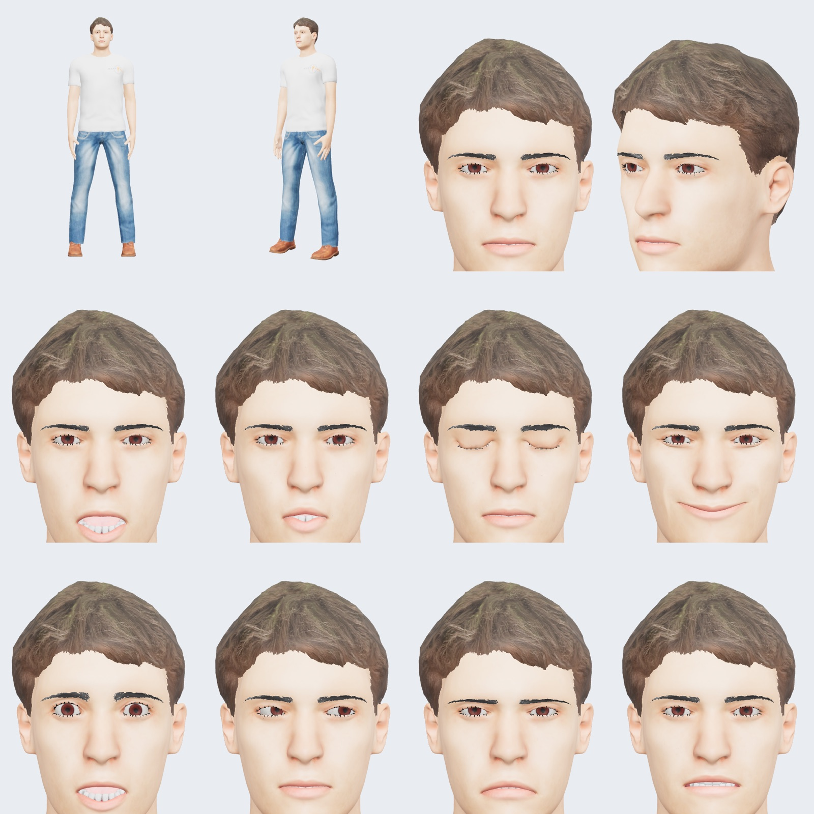

# Digital human: 3D asset requirements and import pipeline

Status: **built in Phase 3** as `coach-01` in [`packages/avatar-assets`](../../packages/avatar-assets)
(sources, licences and rebuild steps: [SOURCES.md](../../packages/avatar-assets/SOURCES.md)). The types
the pipeline fills (`AvatarAssetManifest`, `HUMANOID_BONES`, `ANIMATION_SLOTS`, `ARKIT_BLENDSHAPES`,
`VISEMES`) are in [`packages/avatar-types/src`](../../packages/avatar-types/src).



## What was built (measured 2026-11-10)

| Profile   | File            | Size    | Triangles | Body                                 | Eyes      | Textures              |
| --------- | --------------- | ------- | --------- | ------------------------------------ | --------- | --------------------- |
| HIGH      | `high.glb`      | 5.78 MB | 93,024    | MakeHuman base mesh, subdivided once | high-poly | WebP, at most 2048 px |
| OPTIMIZED | `optimized.glb` | 2.31 MB | 39,388    | MakeHuman base mesh                  | low-poly  | WebP, at most 1024 px |

Both: the `game_engine` rig (53 bones, no eye bones, so gaze uses the `eyeLook*` shapes), the 52 ARKit
shapes and 15 visemes on the body and carried over to brows, lashes, eyes, teeth, tongue and hair, an
`idle` clip (4 s loop: arms down from the A-pose, held; breathing, head and eyes are avatar-core's
procedural layer since Phase 4), the eye centres in the manifest (`eyes`, measured from the eye mesh by
the build), meshopt geometry. `pnpm test` in the
package proves the files match the manifest (see its README).

Where it differs from the targets below, and why:

- **More triangles than planned** (targets: 50–80k and 15–25k). In OPTIMIZED the teeth alone are about
  7,000 triangles and the clothes 7,000. Cutting them is Phase 9 work; the face topology stays, since
  the face shapes live on it.
- **OPTIMIZED is not a separate low-poly body.** Decimating a mesh destroys its shape keys, and MPFB's
  low-poly proxies don't carry them. So OPTIMIZED is the base mesh and HIGH the base mesh subdivided:
  the same face shapes on both, by construction.
- **WebP, not KTX2, for now.** KTX-Software has no Homebrew package and its macOS installer needs an
  admin password; KTX2 also can't be decoded on mobile (no WebAssembly in Hermes) and needs a worker the
  extension's CSP blocks. WebP shrinks the download but not GPU memory. KTX2 for the desktop profile is
  Phase 9.
- **Look:** realistic proportions, not photorealistic. The skin has a colour map only (no normal or
  subsurface map), the irises are MakeHuman's `brown` (reddish), and the hairline has a hard edge
  because hair is alpha-tested. Two-pass hair (alpha-tested core, blended edges) is renderer work.
- **Materials are set by the build, not exported as is:** MPFB's materials came out of Blender as
  transparent and double-sided, which showed the teeth through the face. `materialSettings` makes skin,
  teeth, tongue and clothes opaque, and eyes, hair, brows and lashes alpha-tested.

## What the engine needs from a model

One identity, shipped as two files from the same source:

| Profile   | Used by           | Triangles (target) | Textures                           | Geometry                    |
| --------- | ----------------- | ------------------ | ---------------------------------- | --------------------------- |
| HIGH      | desktop           | 50k to 80k         | skin 4K, others 2K, KTX2           | meshopt                     |
| OPTIMIZED | extension, mobile | 15k to 25k         | 1K to 2K, KTX2 (mobile: see below) | meshopt (mobile: see below) |

Both profiles must have the **same skeleton (bone names and bind pose) and the same morph target names**,
so one set of animation clips and one `AvatarFrame` drive either file. The validator checks this.

File rules:

- glTF 2.0 binary (`.glb`), Y up, metres, facing +Z, feet at the origin, bind pose in T or A pose.
- One skeleton; at most 4 bone influences per vertex.
- Morph targets named in `mesh.extras.targetNames` (three.js reads this):
  - the 52 ARKit blendshapes (`eyeBlinkLeft` … `tongueOut`) on the face mesh, and on the meshes that must
    move with it (eyelashes with the blinks, lower teeth and tongue with `jawOpen`);
  - the 15 Oculus visemes (`sil`, `PP`, `FF`, `TH`, `DD`, `kk`, `CH`, `SS`, `nn`, `RR`, `aa`, `E`, `I`,
    `O`, `U`), or a viseme-to-ARKit table in the manifest when the model only has ARKit shapes.
- Bones for `HUMANOID_BONES` (hips, spine, chest, neck, head, left and right eye). If there are no eye
  bones, the `eyeLook*` blendshapes are used instead.
- PBR metallic-roughness materials. Skin: base colour, normal and roughness maps. Eyes: separate cornea
  and iris meshes. Eyelashes and hair: alpha-tested cards.

Names don't have to match the canonical ones. The manifest maps each canonical name to the model's own
name (`morphTargets.arkit`, `morphTargets.visemes`, `skeleton.bones`), so an export with other names
(Avaturn, a Ready Player Me style export, our own) drops in without code changes.

Mobile caveat (spike S1 decides): Hermes can't run the WebAssembly decoders for KTX2 and meshopt, so the
mobile OPTIMIZED file may need plain geometry and pre-transcoded or PNG/JPEG textures.

## Where the model comes from

You asked me to build the human. The plan, as written before Phase 3 (built as above):

1. **Base: MakeHuman's open assets** (body mesh, skins, eyes, eyebrows, eyelashes, teeth, tongue, hair,
   clothes; the assets are CC0) built in **Blender** with a script, run headless. Blender is not installed
   on this Mac; Phase 3 starts by asking you to install it.
2. **Rig:** a humanoid skeleton with the bones above.
3. **Face shapes:** the 52 ARKit shapes and 15 visemes, made by posing the face rig per shape and baking
   each pose into a shape key. Every shape gets a render in a contact sheet for review.
4. **OPTIMIZED:** a lower-polygon version of the same body (not a decimated copy: decimating destroys
   shape keys), with the shape keys transferred onto it.
5. **Licence record:** every source file with its licence and URL goes into the manifest's `license`
   field and `packages/avatar-assets/SOURCES.md`.

What that gives: a realistic-proportioned, fully rigged human that can blink, look, talk and emote. What it
doesn't give: **photorealism**. A photoreal likeness needs scanned skin and a likeness source, for example
an Avaturn T2 export from your photo, which fits the same slot (see "Importing a model" below). I will not
describe the built model as photorealistic.

Rejected: building the body procedurally in code (like the exercise demo's `extension/lib/demo-body.js`).
It can't reach a realistic face.

## Import pipeline

```
source .blend / vendor .glb
  │  blender --background --python packages/avatar-assets/scripts/export.py   (our own model only)
  ▼
raw .glb (HIGH topology + OPTIMIZED topology)
  │  node packages/avatar-assets/scripts/build-profiles.mjs
  │    ├─ validate: glTF validator, then our checks (bones, morph names, both profiles match)
  │    ├─ clean: dedup, prune, weld; quantize; morph targets kept (sparse)
  │    ├─ textures → KTX2 (UASTC for normal maps, ETC1S for colour), sizes per profile
  │    └─ geometry → meshopt (EXT_meshopt_compression)
  ▼
packages/avatar-assets/models/<id>/{high,optimized}.glb + manifest.json (sizes, sha256, licence)
```

Tools (installed in Phase 3): Blender, `@gltf-transform/cli` and its functions, KTX-Software (`ktx`) for
texture compression, the Khronos glTF validator.

The validator also runs in `pnpm check`, so a broken or mismatched model fails CI.

## Importing a model (for example an Avaturn export)

Not built yet: an `inspect` command that lists a foreign GLB's bones and morph targets and drafts a
manifest for it. The pieces exist (`readGlbJson` and `summarizeGltf` in `avatar-assets`); the command
comes when there is a real export to import. The steps will be:

1. Export the avatar as `.glb` with ARKit blendshapes (and visemes, if offered). In Avaturn, that is the
   T2 body type. Check the exact export options on avaturn.me; I couldn't confirm its morph target names.
2. Put the file in `packages/avatar-assets/sources/<id>/source.glb` and its licence terms in
   `SOURCES.md`.
3. Map its names to the canonical ones in a manifest (the draft the `inspect` command will print).
4. Run the post-processing and `pnpm test`: the checks say exactly what is missing.
