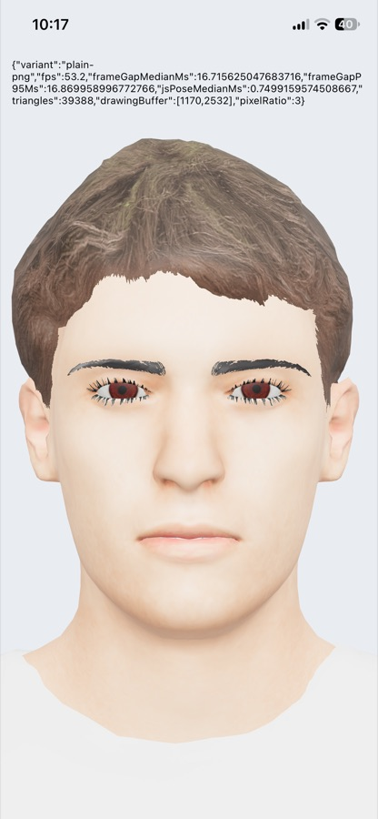
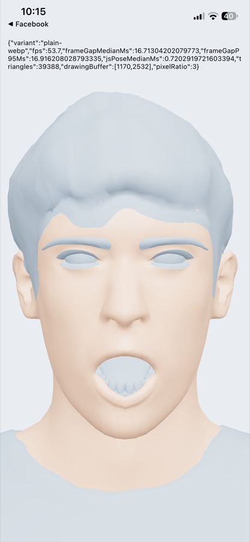

# Spike S1: the mobile renderer on a real iPhone

Done 2026-11-10. **Result: three.js on `expo-gl` through React Three Fiber's native entry draws coach-01
on an iPhone 12 at the display's 60 Hz for at least 95% of frames, with skinning, all face shapes,
textures and the light rig, after three fixes.** Android is not tested yet (you chose iPhone first).

The spike was a throwaway app (`com.squatoverflow.spike`, Expo 56, built in the scratchpad), separate from
the Squat Overflow app, so the installed Squat Overflow build was not touched. Nothing of it is in the
repo except this write-up and two screenshots.

|  |  |
| :------------------------------------------------------: | :-----------------------------------------------------------------------------: |
|                  Textured (PNG variant)                  |                 Untextured run, `jawOpen` morph at full weight                  |

## Setup

- **Device:** iPhone 12 (A14), iOS 27.0.1, a physical device over USB.
- **Stack:** Expo SDK 56, React Native 0.85.3 (Hermes, new architecture), `expo-gl` 56.0.6,
  `expo-asset` 56.0.25, `expo-file-system` 56.0.11, three 0.187.0, `@react-three/fiber` 9.8.2
  (`/native` entry). Release build (no Metro), Xcode 27.2.
- **Model:** coach-01 OPTIMIZED (39,388 triangles, 9 meshes, 53 bones, 67 face shapes on the body) in
  three encodings: the shipped file (meshopt + WebP), plain geometry + WebP, plain geometry + PNG.
- **What the app did:** loaded each variant, then drew one with the studio light rig (environment map +
  lights), the `idle` clip on an `AnimationMixer`, `jawOpen` swinging and a blink every 3 s. It counted
  frames for 10 s and wrote the results to a file that was then copied off the phone.

## Results

| Check                                     | Result                                                                     |
| ----------------------------------------- | -------------------------------------------------------------------------- |
| WebAssembly in Hermes                     | **None.** The meshopt file can't be decoded: the shipped file doesn't load |
| Plain geometry + WebP: load               | Loads (0.3 s): 9 skinned meshes, all face shapes, `idle` clip              |
| Plain geometry + WebP: draw               | **Native crash** (see fix 3)                                               |
| Plain geometry + PNG: load                | Loads (0.4 s), all 9 textures decoded                                      |
| Plain geometry + PNG: draw                | **Works**: textured, skinned, morphs, environment map                      |
| Frame rate (textured, 10 s)               | 53.2 fps average; frame gap median 16.72 ms, 95th percentile 16.87 ms      |
| Frame rate (untextured, 10 s)             | 53.7 fps average; median 16.71 ms, 95th percentile 16.92 ms                |
| JavaScript per frame (clip + face shapes) | 0.75 ms median                                                             |
| Resolution drawn                          | 1170 × 2532 (pixel ratio 3, the screen's own)                              |

So at least 95% of frames land on the display's 60 Hz refresh. A few long frames (most likely shader
compilation right after the first draw) pull the 10 s average down to 53. This is at full screen
resolution, without the face and eye layers of Phase 4 and without audio.

## What it took (each is needed on any React Native client)

1. **`process.emitWarning`.** three 0.187's CommonJS entry warns that it's deprecated by calling Node's
   `process.emitWarning`. React Native's `process` has no such method, so any `require('three')` (R3F's
   native build does one) throws while loading and the app shows a white screen. Fix: a no-op
   `process.emitWarning` before three loads, or make Metro resolve `three` to its ES module build.
2. **`FinalizationRegistry`.** three 0.187 uses it to free GPU textures when their image is
   garbage-collected. Hermes here doesn't have it, so creating the renderer throws. Fix: a no-op stand-in;
   textures are still freed by explicit `dispose()`, which the renderer already does.
3. **Textures must be PNG or JPEG.** R3F's native polyfill hands three textures as `{ localUri }` files;
   `expo-gl` decodes those with stb_image, which reads PNG and JPEG but not WebP. On a failed decode it
   passes a null pointer to the GL driver (`glTexSubImage2D`) instead of raising an error, and the app
   crashes (EXC_BAD_ACCESS in `AGXMetalA14`). That's an `expo-gl` bug worth reporting upstream.
4. **iOS 27 needs the scene lifecycle.** Apps built with the iOS 27 SDK must create their window in a
   `UISceneDelegate`. Expo 56's template doesn't; the spike added a scene manifest to `Info.plist` and a
   `SceneDelegate` that starts React Native. **The Squat Overflow mobile app needs this too:** the
   `withSceneLifecycle` plugin the notes mention was never committed and is gone, so the app's next
   build for an iOS 27 phone will hit this.

Not used: `expo-three` (it requires three ^0.166) and `react-native-filament`, the fallback, which turned
out not to be needed.

## What this means for Phase 8

- **`avatar-renderer-native` on R3F's native entry.** The spike drove three directly (an
  `AnimationMixer`, morph influences, the same `RoomEnvironment` light rig); our own rig code did not run
  on the phone. Since `createAvatarRig`, the camera framing and the light rig are plain three.js with no
  DOM, mobile should share them with the web renderer, and probably the React components too (R3F's
  hooks are the same on both entries). Phase 8 proves that with tests.
- **A third model encoding for mobile:** the OPTIMIZED geometry without meshopt, with JPEG for opaque
  textures and PNG where there's alpha (hair, brows, lashes, eyes, teeth). The PNG-only file was
  9.4 MB; JPEG should bring it down. The build script gets a `mobile` output and the validator checks it.
- **Lower resolution on phones is still open.** R3F's native `Canvas` ignored `dpr={[1, 2]}` and drew at
  the screen's pixel ratio 3. Phase 8 sets it on the renderer and measures again (and on an older
  phone).

## Not tested yet

- **Android** (next, on a physical device, when you have one).
- Older or slower iPhones; a long session (memory, heat); the app in the background and back.
- Alpha-to-coverage on the cutouts (the lashes looked harsh); audio and lip sync (Phase 5).
